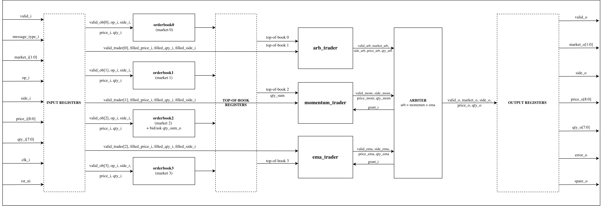
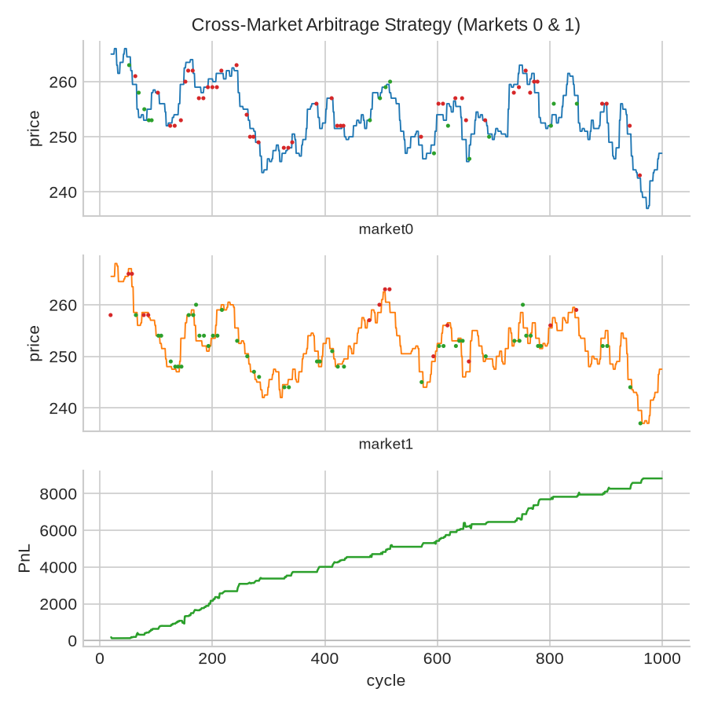
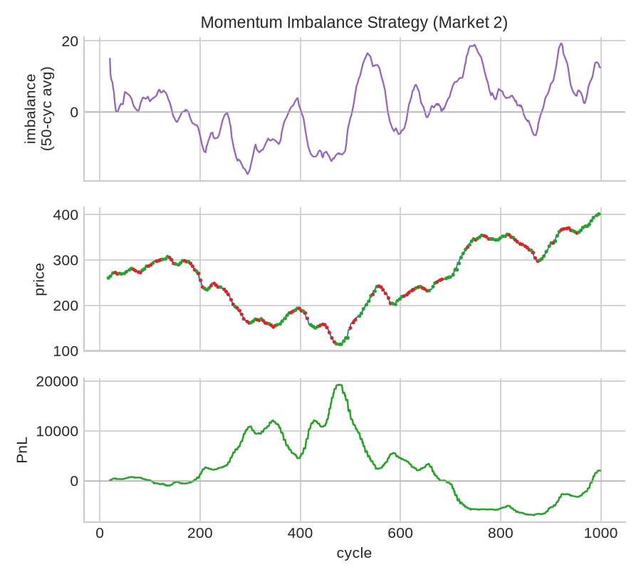
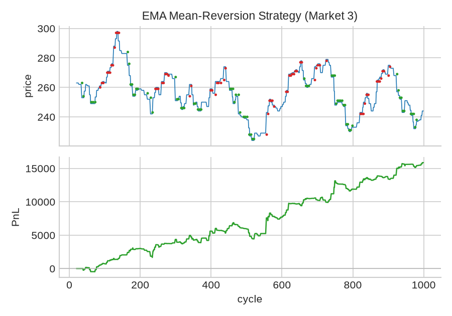

# hft-chip-sky130

A full-custom hardware order book and high-frequency trading engine, replicated and adapted for the **SkyWater 130nm (`sky130A`)** open-source PDK using the open-source **OpenLane** ASIC flow.

Based on the [noah-gigler/hft-chip](https://github.com/noah-gigler/hft-chip) architecture developed at ETH Zürich (originally taped out on IHP SG13G2), this repository provides a fully open-source implementation—from SystemVerilog RTL and C golden models to Verilator co-simulation and automated RTL-to-GDSII physical implementation with **Magic DRC** and **Netgen LVS** clean signoff.

<p align="center">
  
</p>

---

## Architecture Overview

`hft-chip` is a dedicated trading ASIC that maintains multiple financial limit order books in hardware and executes algorithmic trading strategies concurrently with sub-nanosecond processing latency:

- **4 Independent Order Books** (Markets 0 to 3):
  - Tracks bids and asks across $N$ price levels ($N=64$ default, parameterizable from $N=8$ to $N=64$).
  - **Unsorted pool** with a balanced $O(\log N)$ combinational comparator reduction tree to extract the best bid (max price) and best ask (min price) combinationally every clock cycle.
  - Incremental running quantity sum tracking for imbalance signals.
- **3 Concurrent Trading Strategies** (reading only top-of-book):
  - **`arb_trader`** (Markets 0 & 1): Cross-market arbitrage. Signals when one market's bid exceeds the other's ask by more than a threshold.
  - **`momentum_trader`** (Market 2): Order-flow resting imbalance trader. Compares aggregate bid vs. ask depth ($Q_{\text{bid}} - Q_{\text{ask}}$) to anticipate short-term price momentum.
  - **`ema_trader`** (Market 3): Exponential Moving Average (EMA) mean-reversion filter. Fades deviations between the immediate mid-price and the smoothed EMA baseline.
- **Fixed-Priority Combinational Arbiter**:
  - Priority: `arb_trader` > `momentum_trader` > `ema_trader`.
  - Fair retry semantics: Lower-priority traders that lose arbitration hold their quote and retry next cycle—no valid trade is ever silently dropped.
- **3-Stage Registered Pipeline**:
  - Stage 1: Input message boundary register (1 cycle).
  - Stage 2: Order book to strategy top-of-book register (1 cycle).
  - Stage 3: Outbound trade decision register (1 cycle).
  - Total trade latency: **3 clock cycles** from market tick to trade emission.

---

## Strategy Simulation & Scenarios

Each strategy was validated against synthetic market dynamics driven by Ornstein-Uhlenbeck processes. Testbenches dump cycle-exact fill and price data that are rendered using matplotlib.

### 1. Cross-Market Arbitrage (`arb_trader`)
Two correlated markets driven by a shared slow stochastic factor plus a fast mean-reverting basis spread:

<p align="center">
  
</p>

### 2. Order-Flow Momentum (`momentum_trader`)
Order flow resting quantity imbalance causally predicts short-term directional moves:

<p align="center">
  
</p>

### 3. EMA Mean-Reversion (`ema_trader`)
A mean-reverting price process where the trader fades transient excursions from the exponential moving average:

<p align="center">
  
</p>

---

## SkyWater 130nm ASIC Implementation

The design is hardened targeting **SkyWater 130nm (`sky130A`)** with the `sky130_fd_sc_hd` standard cell library using OpenLane 2:

| Metric | SkyWater 130nm Signoff (`hft_core`) |
|---|---|
| **Process** | SkyWater 130nm (`sky130A`) |
| **Standard Cell Library** | `sky130_fd_sc_hd` (High Density) |
| **Clock Frequency Target** | 40 – 100 MHz (Setup clean across corners, $WNS_{\text{hold}} > 0.10$ ns) |
| **Magic DRC** | **Clean (0 errors) ✅** |
| **Netgen LVS** | **Clean (0 errors) ✅** |
| **KLayout XOR** | **Clean (0 differences) ✅** |
| **Antenna Check** | Clean with diode insertion ✅ |

---

## Repository Structure

```
hft-chip-sky130/
├── rtl/                        # SystemVerilog RTL sources
│   ├── orderbook_pkg.sv        # Shared types, widths (9-bit price, 8-bit qty), enums
│   ├── orderbook_unsorted.sv   # Unsorted pool orderbook with log-depth tree (taped-out impl)
│   ├── orderbook_sorted.sv     # Shift-register orderbook (for equivalence verification)
│   ├── orderbook.sv            # Top orderbook wrapper (selects sorted/unsorted)
│   ├── arb_trader.sv           # Cross-market arbitrage strategy
│   ├── momentum_trader.sv      # Order book imbalance strategy
│   ├── ema_trader.sv           # EMA mean-reversion filter & strategy
│   ├── hft_core.sv             # Core integrating 4 books, 3 strategies, priority arbiter
│   ├── hft_chip.sv             # Registered boundary macro wrapper for Sky130
│   └── gl/                     # Synthesizable flattened Verilog for OpenLane
├── sw/                         # C golden models for cycle-accurate co-simulation
│   ├── common.h                # Bitwise models, macros, constants
│   ├── orderbook.{h,c}         # Reference order book C model
│   ├── arb_trader.{h,c}        # Reference arbitrage strategy model
│   ├── momentum_trader.{h,c}   # Reference momentum strategy model
│   └── ema_trader.{h,c}        # Reference EMA strategy model
├── tb/                         # Verilator C++ testbenches
│   ├── Makefile                # Build targets for all units, chip, and scenarios
│   ├── tb_orderbook.cpp        # Sorted order book test harness
│   ├── tb_orderbook_unsorted.cpp # Unsorted order book test harness
│   ├── tb_arb_trader.cpp       # Unit test for arb strategy
│   ├── tb_momentum_trader.cpp  # Unit test for momentum strategy
│   ├── tb_ema_trader.cpp       # Unit test for EMA strategy
│   ├── tb_hft_chip.cpp         # Full 4-market chip co-simulation & scenario driver
│   └── vectors/                # Directed test vectors
├── openlane/                   # SkyWater 130nm hardening configurations
│   ├── hft_core/               # Production N=64 OpenLane configuration
│   └── hft_core_fast/          # Fast N=8 OpenLane configuration for rapid regression
├── scripts/                    # Flow drivers and scenario plotting
│   ├── setup_env.sh            # One-step environment setup (Volare, PDK, sv2v, tools)
│   ├── run_all_tests.sh        # Runs all Verilator testbenches
│   ├── run_scenarios.sh        # Generates market scenarios & plots figures
│   ├── run_openlane.sh         # Executes OpenLane RTL-to-GDS flow
│   └── plot_scenario.py        # Matplotlib scenario visualizer
├── report/                     # Documentation and figures
│   └── figures/                # Strategy PnL & architectural figures
├── spec.md                     # Hardware specification and port contracts
└── README.md                   # Project overview & documentation
```

---

## Getting Started

### 1. Prerequisites (Ubuntu / Debian / WSL2)

Run the automated setup script to install necessary Python packages, `sv2v`, and the SkyWater 130A PDK via Volare:

```bash
./scripts/setup_env.sh
```

Ensure standard build tools and Verilator are installed on your host:
```bash
sudo apt install build-essential verilator docker.io python3-venv
```

---

### 2. Functional Verification & Co-Simulation

All testbenches run locally using Verilator and GCC, co-simulating cycle-by-cycle against the C golden models in `sw/`:

```bash
# Run all unit and chip testbenches (10,000 random cycles each):
./scripts/run_all_tests.sh

# Or run individual testbenches via make:
make -C tb orderbook   # Order book directed & random tests
make -C tb arb         # Cross-market arbitrage trader
make -C tb momentum    # Momentum imbalance trader
make -C tb ema         # EMA mean-reversion trader
make -C tb chip        # Full chip with all 4 markets and priority arbitration
```

---

### 3. Market Scenarios & PnL Visualization

To simulate the 3 trading scenarios under Ornstein-Uhlenbeck market feeds and generate the visual PnL plots:

```bash
./scripts/run_scenarios.sh
```

Plots are saved to `report/figures/*.png`.

---

### 4. SkyWater 130nm ASIC Hardening (OpenLane)

To execute the complete RTL-to-GDSII physical implementation (Yosys synthesis, OpenROAD placement/CTS/routing, Magic DRC, Netgen LVS):

```bash
# Fast verification run (N=8 levels, completes in ~15 mins):
./scripts/run_openlane.sh hft_core_fast

# Full signoff run (N=64 levels):
./scripts/run_openlane.sh hft_core
```

Results, GDSII files, and signoff reports are written to:
`openlane/<design>/runs/<run_tag>/`

---

## License

MIT License — see [LICENSE.md](LICENSE.md).

Architecture and original IHP SG13G2 implementation by Noah Gigler and Luis Wirth (ETH Zürich VLSI II). Reimplemented and hardened for SkyWater 130nm.
